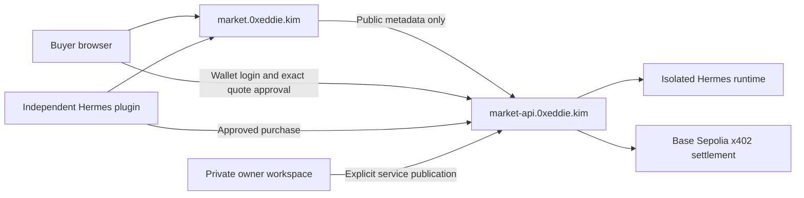

# Public hosting

Hermes Market supports a fixed HTTPS directory and seller API through an existing
Cloudflare Tunnel or equivalent reverse proxy. It does not operate a tunnel network.
Public deployment targets are `https://market.0xeddie.kim` and
`https://market-api.0xeddie.kim`. Deployment verification is recorded separately in
`public-verification-2026-11-11.json`; configuration alone does not establish uptime.

## Traffic and trust



The named tunnel forwards only the directory listener and the public testnet
seller listener. Owner management, the buyer signing gateway, and the Hermes Runs
endpoint remain on separate loopback ports and have no public ingress.

This deployment uses this computer for the directory database and seller runtime.
Both public applications stop when it is off or disconnected. A tunnel provides
connectivity; it is not independent cloud compute or a persistent cloud database.

## Run the public directory

```sh
.venv/bin/hermes-market --state .state/public-directory directory \
  --port 8995 --public-origin https://market.0xeddie.kim \
  --open-registration
```

Public registration accepts HTTPS DNS hostnames on port 443. Seller discovery
resolves and validates every address, connects to a validated public IP while
preserving the Host and TLS name, rejects redirects, and bounds response sizes,
timeouts and concurrency. The public directory accepts only Base Sepolia testnet
contracts. It never requests an owner token, wallet session, skill bundle or order
input. A check alone does not publish a listing: the seller must explicitly publish
a tested service to this exact directory.

Local simulation remains separate:

```sh
.venv/bin/hermes-market --state .state/directory directory \
  --allow-seller http://127.0.0.1:8765
```

## Configure the seller

Follow [local-testnet.md](local-testnet.md) to create the isolated runtime, then
initialize a **separate** seller state directory for the fixed public address:

```sh
.venv/bin/hermes-market --state .state/public init-testnet
```

Edit the generated private `.state/public/testnet/config.json`:

```json
{
  "origin": "https://market-api.0xeddie.kim",
  "listen_port": 8985,
  "admin_port": 8986,
  "directory_origin": "https://market.0xeddie.kim"
}
```

These are fields to change, not a replacement for the complete generated config.
Set the private runtime credential path and isolated runtime identity as described
in the testnet guide. Never mount a personal Hermes home. Keep the authorization key,
owner token, ledger and runtime idempotency state across restarts.

```sh
.venv/bin/hermes-market testnet-doctor --config .state/public/testnet/config.json
.venv/bin/hermes-market testnet --config .state/public/testnet/config.json
```

The HTTPS `origin` is the payment and wallet identity. `listen_port` is only the
local transport endpoint. An existing ledger cannot be moved to another origin.
Keep old orders available at their original address; start a new ledger for a new
address. A temporary tunnel URL that changes on restart is unsuitable for saved
listings, payments or purchase recovery.

## Connect Cloudflare Tunnel

Install `cloudflared` from Cloudflare or a trusted package manager. Authenticate
for the domain, then create a dedicated tunnel. Do not modify another application's
tunnel, apex record or DNS routes.

```sh
cloudflared tunnel login
cloudflared tunnel create hermes-market
```

Use the returned tunnel UUID and private credential-file path:

```sh
.venv/bin/hermes-market tunnel-config \
  --tunnel-id YOUR_TUNNEL_UUID \
  --credentials-file /absolute/private/path/YOUR_TUNNEL_UUID.json \
  --output .state/cloudflare/config.json
cloudflared tunnel --config .state/cloudflare/config.json ingress validate
cloudflared tunnel route dns hermes-market market.0xeddie.kim
cloudflared tunnel route dns hermes-market market-api.0xeddie.kim
cloudflared tunnel --config .state/cloudflare/config.json run hermes-market
```

The generated config ends with a catch-all 404. It contains no route for the
owner, signer or runtime. Verify `/health/ready`, `/ui-config`, registration,
listing discovery and the negative private-route checks through HTTPS before
advertising the deployment. Run long-lived processes under the operating system's
service supervisor. Preserve local ledgers and keys when changing code.

## Install and buy

```sh
hermes plugins install snuff12/hermes-market
hermes plugins enable hermes-market
```

The plugin's default directory is `https://market.0xeddie.kim`. Set `buyer_mode` to
`testnet` and configure a private buyer ledger and its local browser approval
gateway. Wallet signing remains a separate human action. Existing purchases use
their saved seller origin even after another listing is selected.

## Rename compatibility

The product, package, CLI and plugin are named Hermes Market. A few internal v0.1
identifiers deliberately retain their original bytes: encrypted authorization
contexts, listing hashes, browser signing-intent keys and legacy wire contracts.
Changing those bytes can make paid orders unreadable or permit repeated signing.
The original signed payment fixture and historical verification records are kept
as evidence. They are not current product wording.

## Operations and rollback

Mainnet is disabled. Public amounts are Base Sepolia test USDC. The directory
applies a global update limit and bounded registration capacity; it is an early
public demo, not a production availability commitment. Seller-reported usage is
explicitly labeled, while verified reviews require a seller proof, buyer signature
and matching chain receipt.

To stop exposure, stop the dedicated tunnel connector. Leave databases, keys,
runtime volumes and DNS identity intact while existing orders may need recovery.
Do not restore an old ledger without the recovery lock and reconciliation.

Sources: [Cloudflare Tunnel setup](https://developers.cloudflare.com/tunnel/features/locally-managed-tunnels/create-local-tunnel/)
and [ingress configuration](https://developers.cloudflare.com/tunnel/features/locally-managed-tunnels/configuration-file/).
